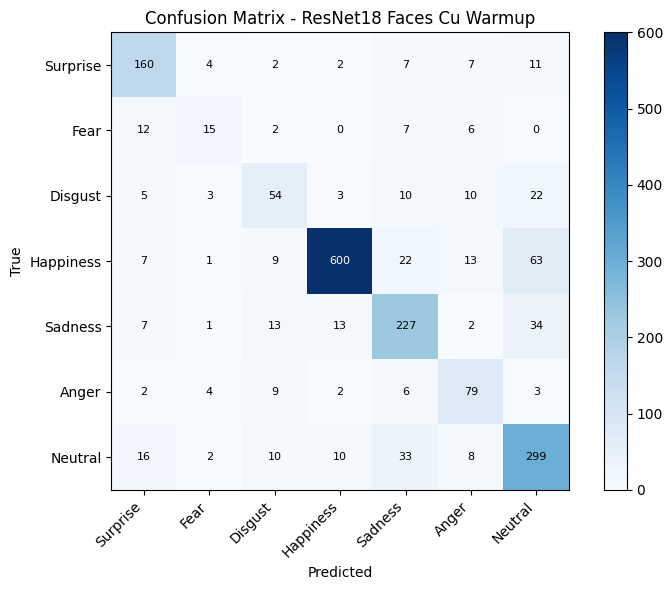
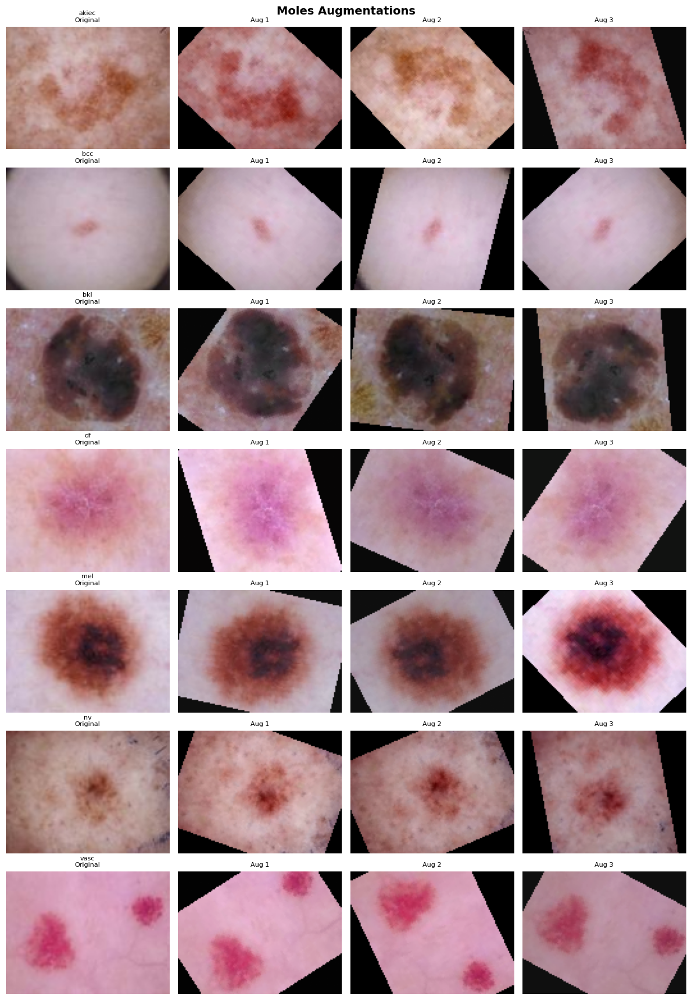

# Image Classification with Deep Learning (PyTorch)

A comparison of deep learning architectures on two 7-class image classification tasks:

| Dataset | Task | Classes |
|---------|------|---------|
| **Skin lesions** (dermatoscopic images) | lesion type | akiec, bcc, bkl, df, mel, nv, vasc |
| **Facial expressions** | emotion | surprise, fear, disgust, happiness, sadness, anger, neutral |

Both datasets are **heavily imbalanced**: in the skin lesion set, `nv` dominates. For this reason the models are evaluated with **macro F1** alongside accuracy.

## Results (validation set)

| Model | Skin lesions: accuracy | Skin lesions: F1 macro | Faces: accuracy | Faces: F1 macro |
|-------|-----------------------:|-----------------------:|----------------:|----------------:|
| MLP + dropout | **0.758** | 0.492 | 0.704 | 0.577 |
| Custom CNN (BatchNorm + augmentation) | 0.757 | 0.448 | 0.694 | 0.481 |
| **ResNet-18** (full fine-tuning + LR warmup, class balancing) | 0.608 | **0.599** | **0.781** | **0.686** |
| MobileNet-v2 (fine-tuning + LR warmup) | 0.554 | 0.510 | 0.735 | 0.661 |

The fine-tuned **ResNet-18** gives the best macro F1 on both datasets:
- on facial expressions it is also the most accurate model, at 78.1%;
- on skin lesions its accuracy is lower than the MLP's, but it recognizes the minority classes much better (macro F1 0.60 vs 0.49), which matters more for a diagnostic task.



## Experiments

### Architectures
- **MLP:** flatten → 2048 → 512 → 128 → 7, with BatchNorm1d, ReLU and optional dropout.
- **CNN:** 4 blocks of `Conv → BatchNorm → ReLU → MaxPool` (32 → 64 → 128 → 256 channels), then global average pooling and a 2-layer classifier with dropout. The first kernel is 5×5 for skin lesions (larger-scale structure) and 3×3 for faces.
- **Transfer learning:** ImageNet-pretrained **ResNet-18** and **MobileNet-v2**, fully fine-tuned. The backbone and the head use different learning rates, with a **linear warmup followed by a cosine schedule**.

### Ablation studies
Each technique is evaluated with and without it, on both datasets:

| Ablation | Plots |
|----------|-------|
| Dropout in the MLP | `figures/ablatie_dropout_*.png` |
| BatchNorm in the CNN | `figures/ablatie_bn_*.png` |
| Data augmentation (none / geometric / color / all) | `figures/ablatie_aug_*.png` |
| LR warmup for fine-tuning | `figures/ablatie_warmup_*.png` |
| Class imbalance: weighted sampler + weighted loss | `figures/ablatie_imbalance_*.png` |

The augmentations are chosen per domain:
- skin lesions get vertical/horizontal flips and 180° rotations (lesions have no natural orientation), but only subtle color jitter, because color carries diagnostic information;
- faces get horizontal flips only, with small rotations and crops.



### Bonus: curriculum learning (faces)
- **Pacing function:** training starts on the easiest examples, ranked by a precomputed difficulty score, and the fraction of data used grows each epoch. Macro F1 improves from 0.481 (baseline CNN) to **0.520**.
- **Self-paced learning:** the model selects the samples with the lowest loss at each step. This underperformed (macro F1 0.272).

## Running

```bash
pip install -r requirements.txt
jupyter notebook image_classification.ipynb
```

The datasets are not included (course-provided). The notebook expects `train/`, `test/`, `kaggle_test/`, the matching CSV files and `splits/norm_stats.json` in the working directory. Training uses CUDA if available. Logs are written to `runs/` for TensorBoard. The notebook commentary is in Romanian.

## Repository layout

```
image_classification.ipynb   data loading, models, training loops, ablations, evaluation (with outputs)
figures/                     confusion matrices, ablation curves, augmentation previews
```

## Credits

Developed as an assignment for the *Artificial Intelligence* course at the Faculty of Automatic Control and Computers, Politehnica University of Bucharest (2026). The experiments and the code are my own work.
